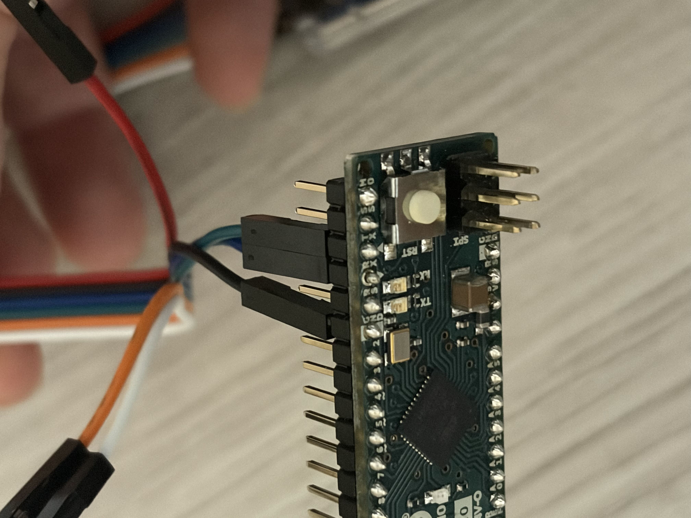
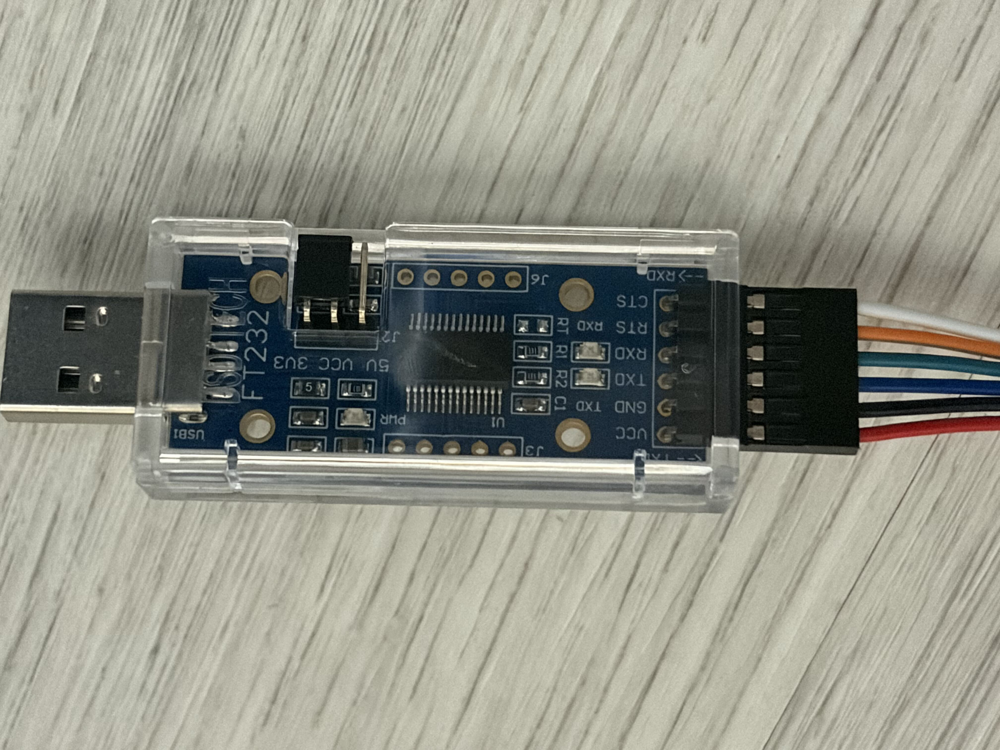

# Arduino Micro を使った Switch コントローラー

Arduino Micro を Switch ドックに USB 接続し、Windows PC から SH-U09C を通じて操作します。ここでは、手元で動作を確認した配線と切り替え手順を説明します。

## 全体の接続

```text
Windows PC ── USB ── SH-U09C ── TXD / RXD / GND ── Arduino Micro ── USB ── Switch ドック
     │                                                                      │
     └──── USB ── キャプチャー機器 ────────────── HDMI ─────────────────────┘
```

映像を使う場合は、Switch ドックの HDMI 出力をキャプチャー機器の HDMI 入力に接続し、キャプチャー機器を USB で Windows PC に接続します。

## SH-U09C と Arduino の配線

両方の USB を外した状態で接続してください。端子名を確認し、TX と RX を交差させます。

| SH-U09C | Arduino Micro |
| --- | --- |
| TXD | 0 / RX |
| RXD | 1 / TX |
| GND | GND |

SH-U09C の **VCC は Arduino につなぎません**。Arduino は Switch ドックの USB から給電します。6本の線が一体になったコネクターを SH-U09C に使う場合も、Arduino につなぐのは上記の3本です。

Arduino Micro 側の配線例です。基板の `TX`・`RX`・`GND` の印字を確認してください。



SH-U09C 側の端子と6本のコネクターです。写真では全端子に線が付いていますが、Arduino に接続するのは表の3本です。



**この SH-U09C の写真はジャンパーを切り替える前の状態です。** 写真の位置をそのまま真似せず、次の「電圧ジャンパー」の手順で設定してください。

### SH-U09C の電圧ジャンパー

手元の SH-U09C は、USB 端子付近の `3V3`・`VCC`・`5V` と表示された3本のピンに、黒いジャンパーを差して切り替えます。**USB を両方外してから**、ジャンパーを `VCC` と `5V` の2本にかぶせます。これは電圧設定用のジャンパーであり、Arduino に VCC をつなぐ指示ではありません。

```text
3V3   VCC   5V
       └────┘
      ジャンパー
```

基板の表示やピン配置は製品・バージョンによって異なる場合があります。使用する機器の表示を確認してください。

## Arduino で操作するとき（確認した環境）

配線した状態で、次の順に操作します。

1. Arduino Micro の USB を Switch ドックに接続する。
2. SH-U09C の USB を Windows PC に挿し直す。
3. 白いコントローラーの接続を切る。
4. 白いコントローラーの電源を切る。
5. SH-U09C の USB を Windows PC に挿し直す。
6. 白いコントローラーの電源を入れ、Switch に接続する。
7. 白いコントローラーの接続を切る（電源は切らなくてよい）。
8. Windows から Arduino にボタンを送り、Switch が反応することを確認する。

この手順は手元の白いコントローラーで動作したものです。ほかの機材や環境では動作が異なる場合があります。Switch の「Proコントローラーの有線通信」を ON にして使います。

## 手動コントローラーで操作するとき

1. Arduino Micro と Switch ドックをつないでいる USB を抜く。
2. SH-U09C の USB を Windows PC に挿し直す。
3. 白いコントローラーを Switch に接続する。

再び Arduino で操作するときは、上の「Arduino で操作するとき」の手順を実行します。

## ファームウェア

Dev Container 内で `./controller/switch_arduino_micro/build.sh` を実行するとコンパイルできます。Windows からの書き込みは [書き込み手順](../../docs/windows-arduino-upload.md) を参照してください。

`src` には [Arduino SwitchJoystick Library](https://github.com/squirelo/Arduino-JoyCon-Library-for-Nintendo-Switch) の commit `459b332cf47e08c030d16887b94d45141a13d268` から取得したコードを含みます。スケッチ内でビルドできるようヘッダーの include を相対パスに変更しています。ライセンスは [LICENSE-SwitchJoystick](src/LICENSE-SwitchJoystick) を参照してください。
